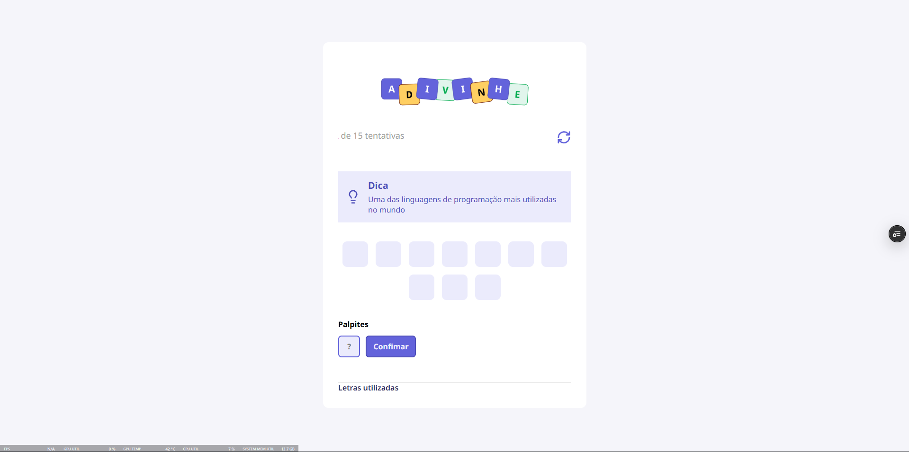

# 🎯 Adivinhe

Um jogo de adivinhação de palavras desenvolvido com React e TypeScript. Use as dicas para descobrir a palavra secreta, tente acertar suas letras e desafie sua lógica!

## 📸 Demonstração



## ✨ Funcionalidades

- 🔤 Adivinhar palavras por meio de letras.
- 💡 Receber dicas para descobrir a palavra secreta.
- 📊 Acompanhar o número de tentativas utilizadas.
- ✅ Visualizar as letras corretas e incorretas.
- 🔄 Reiniciar a partida a qualquer momento.
- 🏆 Receber feedback ao vencer ou esgotar as tentativas.

## 🛠️ Tecnologias utilizadas

- **React** — construção da interface.
- **TypeScript** — tipagem estática e organização do código.
- **Vite** — ambiente de desenvolvimento e build.
- **CSS Modules** — estilização dos componentes.

## 🚀 Como executar o projeto

### Pré-requisitos

- [Node.js](https://nodejs.org/)
- npm (incluído na instalação do Node.js)

### Instalação

1. Clone este repositório:

   ```bash
   git clone URL_DO_SEU_REPOSITORIO
   ```

2. Entre na pasta do projeto:

   ```bash
   cd adivinhe
   ```

3. Instale as dependências:

   ```bash
   npm install
   ```

4. Inicie o servidor de desenvolvimento:

   ```bash
   npm run dev
   ```

5. Acesse o endereço indicado no terminal, geralmente `http://localhost:5173`.

## 📚 Aprendizados

Este projeto foi desenvolvido para praticar conceitos de desenvolvimento front-end, incluindo componentes reutilizáveis, gerenciamento de estado com React Hooks, tipagem com TypeScript e estilização com CSS Modules.

## 👨‍💻 Autor

**Luis Felipe Felizardo**

- [GitHub](https://github.com/SEU_USUARIO)

---

Feito com 💜 e código.
